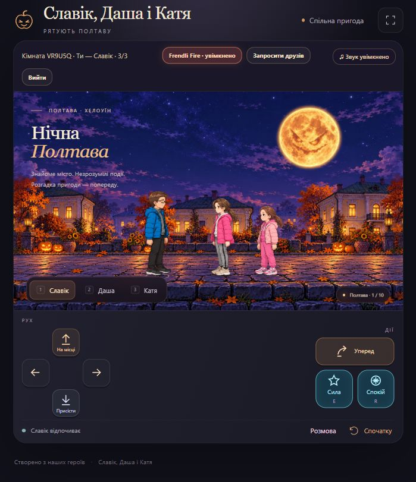

# Славік, Даша і Катя — рятують Полтаву

Мережева версія 0.6.0. Троє друзів грають із різних комп’ютерів або смартфонів у спільній кімнаті. Двоє можуть бути в одному Wi-Fi, а третій — через інтернет. Кожен керує обраним героєм.



## Як грати

1. Відкрий гру, обери героя та натисни **Створити кімнату**.
2. Передай друзям код або посилання через **Копіювати запрошення**.
3. Кожен друг обирає свого героя й приєднується. Зайнятого героя перехопити неможливо.
4. Автор кімнати натискає **Почати пригоду**. Можна почати й одному: вільними героями керує гра. Друзі можуть приєднатися пізніше.

Після короткої втрати зв’язку гра повертає гравця до його героя. Під час відключення героя підхоплює автоматичне керування; місце зберігається 30 секунд. Токен повернення залишається лише у вкладці гравця й не передається іншим учасникам. Перезавантаження вкладки відновлює підключення, поки кімната існує. Кнопка **Вийти** звільняє героя відразу.

## Керування

| Дія | Клавіатура |
| --- | --- |
| Рух | A / D або ← / → |
| Стрибок | Пробіл; із напрямком — уперед |
| Присісти | S або ↓ |
| Дві здібності | E та R |
| Розмова / підказка | T |
| Падіння та підйом | Enter |
| Обрати вільного героя | 1, 2, 3 або кнопки персонажів |

Смартфон підтримує керування двома руками та окрему кнопку стрибка вперед. Перемикатися можна лише на вільного героя. На арені камера спільно кадрує боса, усі троє автоматично заходять на арену. Після повної анімації поразки камера плавно повертається до власного героя.

## Frendli Fire

У кожного гравця є власна кнопка **Frendli Fire**. Спочатку режим вимкнений у всіх.

Увімкнення дозволяє взаємні влучання за участю цього гравця. Наприклад, якщо кнопку ввімкнув лише Славік, він може влучати в Дашу й Катю, а вони — у Славіка. Даша й Катя між собою не влучають, доки хтось із них теж не ввімкне режим.

Будь-яке з шести заклинань збиває іншого гравця й запускає погоджену анімацію падіння. Власного героя та автоматичних супутників дружній вогонь не зачіпає. Режим кожного перевіряє сервер; увімкнути його за іншого гравця неможливо.

## Привиди, боси та фінал

Збережено карту Полтави на десять екранів, три шари паралаксу, випадкові руки, скрімерів, шість заклинань, чотирьох босів, репліки й фінальний добрий місяць-кролик. Боси мають спільні для кімнати комбінації, вразливість і поступ. Під час серій Галушуна й Пана Ґнота ухилятися мають усі присутні гравці; супутники роблять це автоматично.

**Будь-яким заклинанням тепер можна збити привида-скрімера.** Він розсіюється й перестає збивати героїв. Це також додано до окремої звичайної офлайн-гри.

## Музика та звуки

Оригінальна зациклена мелодія **«Нічні вогники Полтави»**: вісім тактів, 112 ударів за хвилину, ля мінор. Додано 22 ефекти: рух і падіння, чари трьох героїв, привиди, влучання, перемога, підготовка та атаки босів.

Підказки **стрибнути** та **присісти** мають різні звуки. Під час попереджень музика трохи стихає. Кнопка **Звук** вимикає музику й ефекти; браузер активує звук після першого натискання або дотику. Усі аудіофайли локальні, без зовнішніх аудіосервісів та озвучки голосів.

## Запуск на ноутбуці

Потрібний Node.js 24. Встановлення єдиної залежності потрібне один раз:

```sh
npm install --ignore-scripts
npm start
```

Відкрий http://127.0.0.1:8780/. Для інших пристроїв у тому самому Wi-Fi використай локальну адресу ноутбука з портом 8780. За потреби дозволь Node.js працювати в приватній мережі у вікні брандмауера Windows. Адреса 127.0.0.1 працює лише на самому ноутбуці.

## Завантаження на GitHub

Завантаж **вміст цієї папки** в окремий репозиторій. Додай також приховані `.github/`, `.nojekyll` і `.gitignore`. Архіву, великих самодостатніх HTML, `node_modules/` і папок збірок тут немає.

Це окрема мережева версія. Папка попередньої офлайн-версії не замінюється. Наявність файлів на GitHub ще не запускає сервер кімнат.

## Підключення через інтернет

Підготовлено звичайний Node.js-сервер. Його можна розмістити на сервісі з підтримкою постійних WebSocket-з’єднань, наприклад Render. Файл `render.yaml` містить готову конфігурацію. Публікацію та створення облікових записів цей пакет сам не виконує.

Для першого запуску через Render:

1. Підключи цей репозиторій як **Web Service** із середовищем Node.
2. Команда збірки: `npm install --omit=dev --ignore-scripts`.
3. Команда запуску: `npm start`. Версія Node: `24`. Перевірка стану: `/health`.
4. Залиш **один екземпляр сервера**: кімнати зараз живуть у пам’яті одного процесу.
5. Дочекайся адреси сервісу. Вона відкриває і гру, і сервер кімнат — усі троє вже можуть користуватися цим одним посиланням.

[Офіційна інструкція Render](https://render.com/docs/deploy-node-express-app), [підтримка WebSocket](https://render.com/docs/websocket). На безкоштовному плані сервіс може засинати після простою й запускатися з паузою; [обмеження плану](https://render.com/docs/free). Після перезапуску сервера поточні кімнати потрібно створити знову; збереження проходження між запусками поки немає.

### Якщо сторінка гри має залишитися на GitHub Pages

1. Спочатку запусти сервер кімнат, як описано вище.
2. У репозиторії відкрий **Settings → Secrets and variables → Actions → Variables** й додай змінну `ROOM_SERVER_URL` з HTTPS-адресою сервера, наприклад `https://your-game.onrender.com`.
3. У налаштуваннях серверного сервісу додай `ALLOWED_ORIGINS=https://YOUR-LOGIN.github.io`. Потрібна лише адреса походження, без назви репозиторію; кілька адрес розділяй комами.
4. У **Settings → Pages → Source** обери **GitHub Actions** і запусти workflow **Check and publish game**. Він перевірить гру й збере `_site/` зі вказаною адресою кімнат.
5. Діти відкривають адресу GitHub Pages; підключення до кімнат відбувається через захищений WebSocket до окремого сервера.

Якщо адреса серверу не налаштована, сторінка Pages повідомить, що кімнати поки недоступні. Облікові записи дітям у грі не потрібні.

## Перевірки й файли

```sh
npm test
npm run build
```

Перевірки охоплюють три реальні мережеві підключення, окреме керування, зайняті місця, повернення після відключення, ізоляцію кімнат, усіх босів, дружній вогонь, збивання скрімерів, музичний цикл та звуки попереджень і атак.

`server/simulation.mjs` виконує ігрову логіку; браузер передає лише кнопки, а не власні координати чи перемоги. `server/index.mjs` керує кімнатами. `multiplayer.mjs` показує спільний стан із згладжуванням та локальним відгуком керування. `audio.mjs` відтворює локальні звуки. `docs/release.json` фіксує склад версії та контрольні суми.
